<em>👨‍💻 Developer in Maputo, Mozambique · C#, React, Next.js and TypeScript · Web, desktop and education · Learning and building in public 🚀</em>

---

## 👋 About me

Hello! I'm **Clávio Bahama** 👨‍💻 — a developer based in **Maputo, Mozambique** 🌍.

My **main project is Bahamaflix** 🏆 — a catalog of movies, series and cartoons published on GitHub Pages, with instant search, an episode guide and an installable PWA. I also build **web** applications with React, Next.js, TypeScript and Tailwind, such as **FreelaMZ** (a freelancer marketplace for Mozambique) and the **Bahama Solution** e-commerce store. **bahama-flix** is a separate, unrelated project: a Next.js streaming platform. I write **APIs** with Node.js, Express and MySQL, and keep **HTML/CSS/JS** materials for beginners 📚.

On the **desktop**, I created **Bahama Studio** 🪟 — a C#/WPF manager for ExplorerBlurMica — and I practice C# with Windows Forms exercises and REST API consumption. That's only part of what I've built. 🧩

There are **20 public repositories** here. This profile is my **living portfolio**: code, learning and projects all in one place. Always learning, always building. 🚀

 

---

## 🛠️ My stack

  

**Most frequent languages in my repositories:**

  

**🚀 Currently growing:** Next.js · Tailwind CSS · TypeScript · REST APIs

---

## 📫 Connect with me

---

## 📊 GitHub stats

  

## 🗣️ Top languages

  

## 🔥 Streak stats

  

## 📈 Activity graph

---

## 🕹️ Contribution Pac-Man

<picture>
  <source media="(prefers-color-scheme: dark)" srcset="https://raw.githubusercontent.com/ClavioBahama/ClavioBahama/output/pacman-contribution-graph-dark.svg" />
  <source media="(prefers-color-scheme: light)" srcset="https://raw.githubusercontent.com/ClavioBahama/ClavioBahama/output/pacman-contribution-graph.svg" />
  
</picture>

---

## 👀 Profile views counter

 

---

## ⭐ Featured projects

### 🏆 Main project

 

 

 

343 titles · 45 public-domain works · 24 series with episode guides · offline-ready PWA

 

Standalone project — unrelated to <code>bahama-flix</code> (a Next.js streaming platform).

   

  

 

 

  

  

 

  

  

 

 

  

---

