<em>👨‍💻 Desenvolvedor em Maputo, Moçambique · C#, React, Next.js e TypeScript · Web, desktop e educação · Aprendendo e construindo em público 🚀</em>

---

## 👋 Sobre mim

Olá! Eu sou o **Clávio Bahama** 👨‍💻 — desenvolvedor baseado em **Maputo, Moçambique** 🌍.

Construo aplicações **web** com React, Next.js, TypeScript e Tailwind: do catálogo de streaming **bahama-flix** ao e-commerce da **Bahama Solution**, passando por um projeto de educação em saúde sexual. Também escrevo **APIs** com Node.js, Express e MySQL e mantenho materiais de **HTML/CSS/JS** para quem está começando 📚.

No **desktop**, criei o **Bahama Studio** 🪟 — um gerenciador em C#/WPF para o ExplorerBlurMica — e pratico C# com exercícios de Windows Forms e consumo de API REST. É só uma parte do que já construí. 🧩

São **20 repositórios públicos** por aqui. Este perfil é o meu **portfólio vivo**: código, aprendizado e projetos em um só lugar. Sempre aprendendo, sempre construindo. 🚀

 

---

## 🛠️ Minha Stack

  

**Linguagens mais presentes nos meus repositórios:**

  

**🚀 Em evolução:** Next.js · Tailwind CSS · TypeScript · APIs REST

---

## 📫 Conecte-se comigo

---

## 📊 GitHub Stats

  

## 🗣️ Top Languages

  

## 🔥 Streak Stats

  

## 📈 Activity Graph

---

## 🕹️ Pac-Man de contribuições

<picture>
  <source media="(prefers-color-scheme: dark)" srcset="https://raw.githubusercontent.com/ClavioBahama/ClavioBahama/output/pacman-contribution-graph-dark.svg" />
  <source media="(prefers-color-scheme: light)" srcset="https://raw.githubusercontent.com/ClavioBahama/ClavioBahama/output/pacman-contribution-graph.svg" />
  
</picture>

---

## 👀 Contador de visitas

---

## ⭐ Projetos em destaque

### 🌐 Web & produtos

| Projeto | Descrição | Stack |
| :--- | :--- | :--- |
| [**bahama-flix**](https://github.com/ClavioBahama/bahama-flix) | Plataforma de streaming Bahama Flix. | `TypeScript` `Next.js` `React` `Tailwind` |
| [**bahama-solution-ecommerce**](https://github.com/ClavioBahama/bahama-solution-ecommerce) | E-commerce da Bahama Solution. | `TypeScript` `Next.js` `React` `Tailwind` |
| [**saudesexual**](https://github.com/ClavioBahama/saudesexual) | Projeto web de educação em saúde sexual. | `TypeScript` `React` `Vite` |
| [**Cadastro**](https://github.com/ClavioBahama/Cadastro) | API de cadastro com Node.js/Express e MySQL. | `JavaScript` `Node.js` `Express` `MySQL` |

### 🖥️ Desktop & C#

| Projeto | Descrição | Stack |
| :--- | :--- | :--- |
| [**BahamaStudio**](https://github.com/ClavioBahama/BahamaStudio) | Gerenciador visual WPF para o ExplorerBlurMica 2.1.0, com backup e reversão automática. | `C#` `.NET` `WPF` |
| [**PTP_CSharp**](https://github.com/ClavioBahama/PTP_CSharp) | Exercícios da aula de C# com Windows Forms. | `C#` `WinForms` |
| [**PHP_Consumo_API**](https://github.com/ClavioBahama/PHP_Consumo_API) | Trabalho de programação C# — consumo de API REST. | `C#` `API REST` |

### 📚 Estudos, portfólios & páginas

| Projeto | Descrição | Stack |
| :--- | :--- | :--- |
| [**Aprender-A-Programar**](https://github.com/ClavioBahama/Aprender-A-Programar) | Materiais e editor para aprender HTML/CSS/JS ⭐ | `HTML` `CSS` `JavaScript` |
| [**Bravura**](https://github.com/ClavioBahama/Bravura) | Aplicação React criada com Create React App. | `JavaScript` `React` |
| [**portfolio**](https://github.com/ClavioBahama/portfolio) | Portfólio pessoal em HTML/CSS/JS. | `HTML` `CSS` `JavaScript` |
| [**port-f-lio**](https://github.com/ClavioBahama/port-f-lio) | Portfólio baseado no template SnapFolio. | `HTML` `CSS` `Bootstrap` |
| [**lelio_chemane**](https://github.com/ClavioBahama/lelio_chemane) | Site pessoal / portfólio de Lélio Chemane. | `HTML` `CSS` |

 

---

